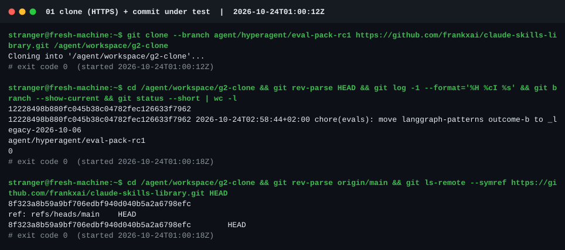
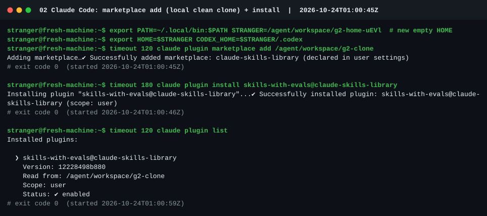
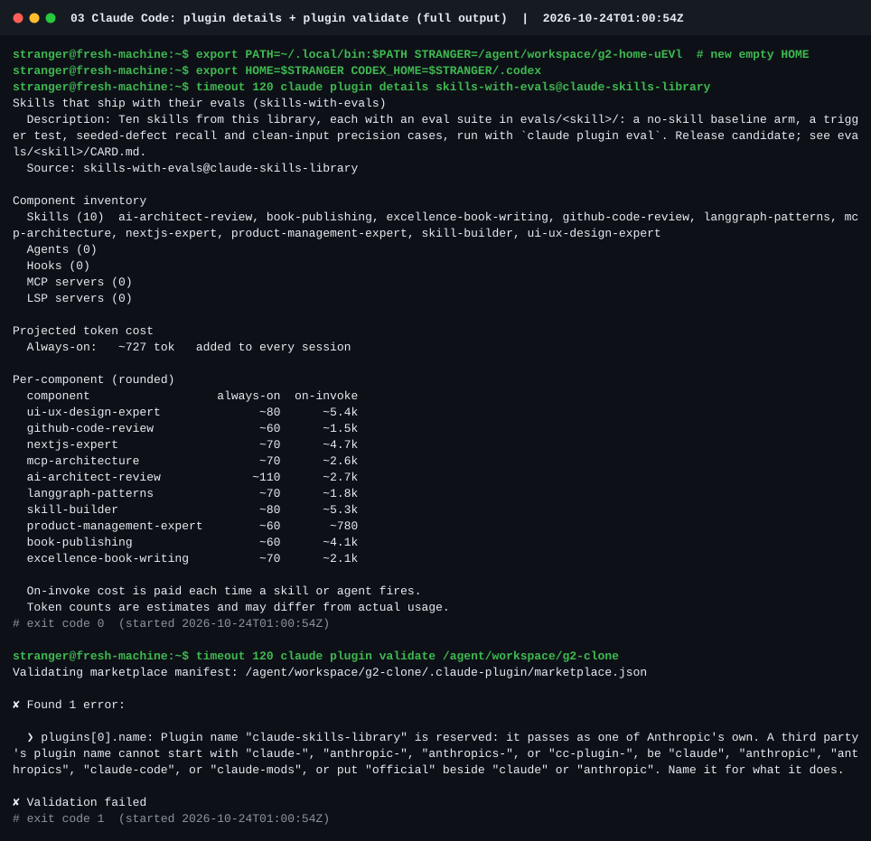
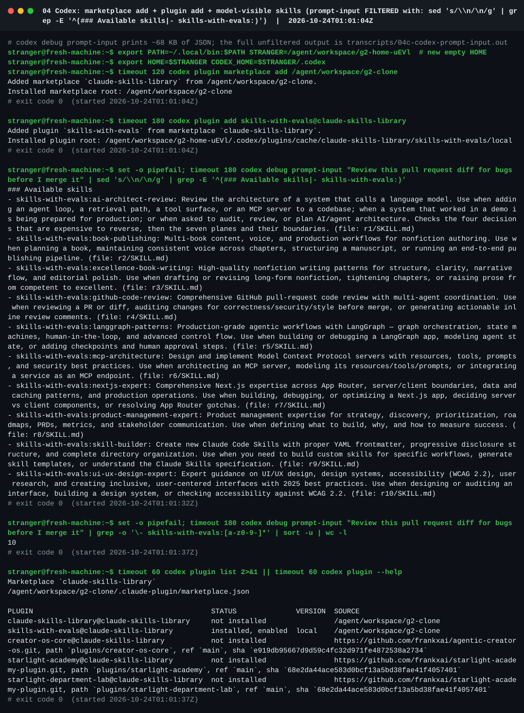
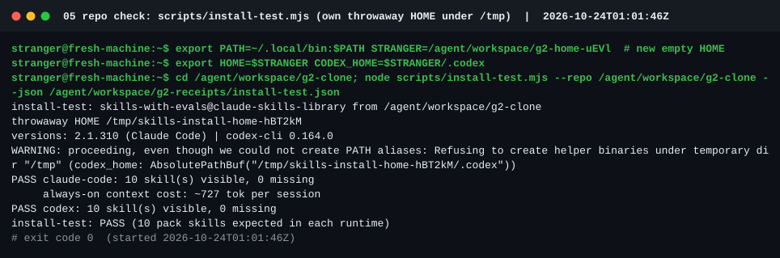
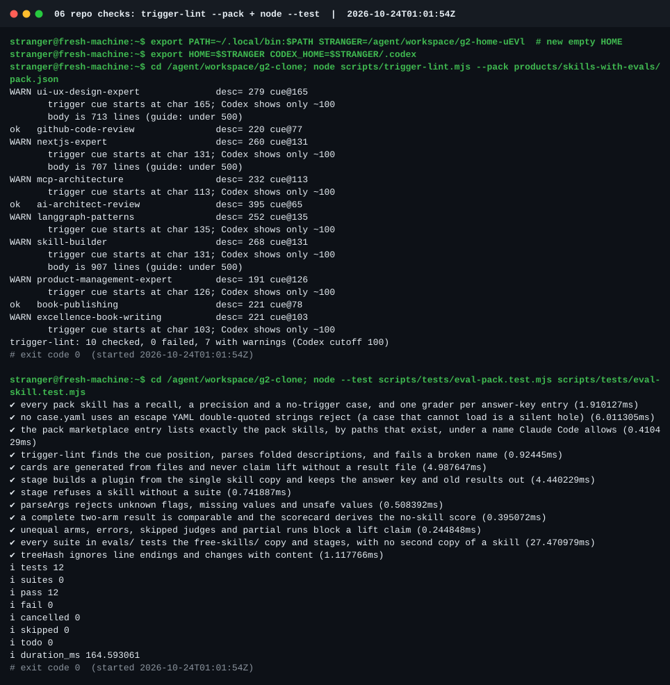
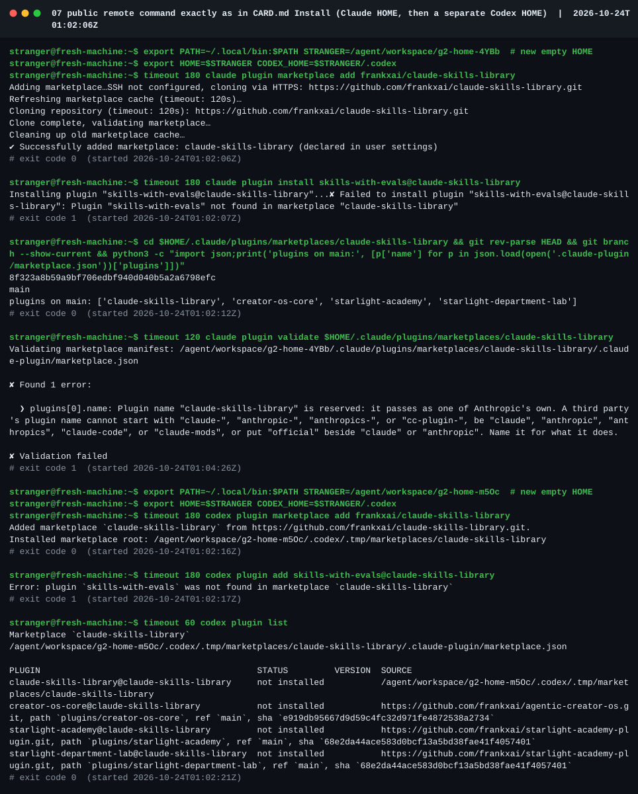
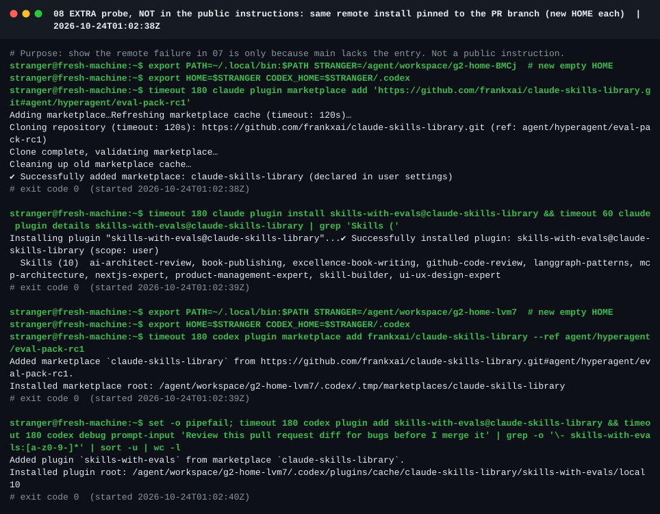

# G2 · A stranger installs the pack from a clean clone

**Who:** an independent subagent with no project context, which followed only the public instructions. It
made no repository changes and no GitHub writes, and used a new empty HOME per runtime.
**When:** 2026-10-24, 01:00:12Z to 01:04:26Z UTC. **Tested commit:** `1222849` (branch head at the time).
**Tools:** Claude Code 2.1.310, codex-cli 0.164.0, node v24.22.1. No model login (installing needs none).
Full report, verbatim: [`G2-REPORT.md`](G2-REPORT.md).

## Verdicts

| Check | Result |
|---|---|
| Local clean-clone install, Claude Code | **PASS**: 10/10 skills in `plugin details`, none missing, none extra |
| Local clean-clone install, Codex | **PASS**: 10/10 `skills-with-evals:*` skills in the model-visible list |
| Repo checks from the clone | **PASS**: `install-test.mjs` both runtimes; `trigger-lint --pack` 10 checked, 0 failed; `node --test` 12/12 |
| Public remote install, command as written in the cards at `1222849` | **FAIL** in both runtimes: `main` has no `skills-with-evals` entry yet (`Plugin "skills-with-evals" not found in marketplace "claude-skills-library"`) |
| Same remote install pinned to the PR branch (extra probe, not a public instruction then) | **PASS** in both runtimes |

## What the stranger found, and what changed

| # | Finding | Status |
|---|---|---|
| 1 | Card install commands point at `main`, which lacks the entry, so they fail before merge | **Fixed in `0424453`** (pushed while G2 ran): cards, README and `codex.md` now pin the branch (`#ref` for Claude Code, `@ref` for Codex). That is exactly the extra probe that passed |
| 2 | README had no install section | **Fixed in `0424453`** |
| 3 | Codex showed the pack's descriptions **in full**, with no ~100-character cut | **Our claim was wrong as stated.** Codex trims by a shared budget, not a fixed width: full text at ≤ 40 installed skills, about 104 characters at 114. Measured in [`../codex-skill-list-budget.md`](../codex-skill-list-budget.md); every mention in this PR corrected |
| 4 | `install-test.json` captured a Codex PATH-alias warning inside `versions.codex` | **Fixed:** warning lines are filtered from version strings |
| 5 | The plugin's homepage link (`…/tree/main/evals`) is a 404 before merge | **Fixed:** points at the repository root |
| 6 | `claude plugin validate` fails on the *other* entry (`claude-skills-library`, reserved name), on `main` too | Open, Frank's decision (rename changes the public install id) |

## Screenshots

Rendered from the stranger's captured transcripts (stdout and stderr verbatim, wrapped at 120 columns, nothing
edited; filtering is labelled in the title). The originals were PNGs; these SVGs render the same text so they
can live in the repository.

### 01 · Clone and commit under test

### 02 · Claude Code: marketplace add (local clone) and install

### 03 · Claude Code: plugin details and validate

### 04 · Codex: install and the model-visible skill list (filtered)

### 05 · `scripts/install-test.mjs`

### 06 · Trigger lint and tests

### 07 · Public remote command exactly as the cards said at `1222849` (fails before merge)

### 08 · Extra probe: the same remote install pinned to the PR branch (passes)

